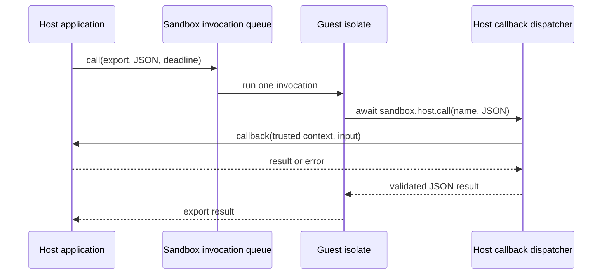

# Host and sandbox interoperability

The bridge is an asynchronous JSON RPC boundary. Host code calls a prepared
module export; guest code calls an explicitly granted host capability. JavaScript
objects, Python objects, Rust references and function closures do not cross the
boundary directly. Each side owns its heap and the bridge owns its serialized
messages and native callback registrations.

## API contract

| Host | Call input/result | Callback input/result | Completion and cancellation |
| --- | --- | --- | --- |
| Rust | `serde_json::Value` | bounded JSON bytes | futures, invocation deadline, trusted cancellation token |
| Node | JSON value | JSON value | Promise, `AbortSignal`, explicit close/shutdown |
| Python | JSON text | JSON text | asyncio awaitable, task cancellation, explicit close/shutdown |
| C / Go | owned/borrowed JSON buffers / JSON bytes | native callback buffers / JSON bytes | polling / context-aware adapter |

Keep business capabilities coarse enough to do useful work, such as
`orders.readMany`, rather than exposing one callback per property access. A
single bounded JSON array can batch work through an existing capability; this
does not require a new batch scheduler. Validate the total message size and
business scope for the whole request.

Register a stable set of capabilities once per engine, and attach request scope
through each sandbox's grants. Do not register a newly named callback for every
request: the registry is bounded and individual unregister is not yet exposed.

The existing APIs deliberately do not return live guest objects or callable
guest function handles. Typed convenience clients can sit above JSON. A future
binary-message API would need explicit buffer ownership, byte budgets and
release/detach semantics; replacing JSON with a host pointer is not equivalent.

## Async execution and reentry

Calls to one sandbox are serialized. Different sandboxes can execute
concurrently. One guest invocation may await several host operations, within
its local and shared admission budgets. `async` makes a wait composable; it
does not make the isolate execute two exported invocations at once.

Host callbacks run outside the isolate and registry locks. In the current
implementation each callback dispatch creates a native thread; an async Rust
callback also creates a current-thread Tokio runtime. This separates callback
execution from supervisor control, but adds fixed scheduling and runtime setup
cost. It also means the callback's current Tokio runtime is not the application's
runtime. If a client must run on the application's executor, capture its trusted
runtime handle and await the submitted work explicitly.

The current Deno adapter also creates and joins a watchdog thread for each
invocation. The pure-echo benchmark includes that cost. A persistent watchdog
or callback executor is a separate optimization with its own cancellation and
shutdown requirements; the benchmark does not attribute all latency to JSON.

Do not await another call to the same sandbox from its callback. The current
invocation is waiting for that callback, so the queued nested call cannot run.
Cycles such as sandbox A calling B which then awaits A have the same problem.
Use a host service, return a continuation result, or split the operation into
separate invocations. An ordinary queued concurrent call is valid; rejecting all
calls whenever an isolate is busy would break that API.

Callbacks should await all invocation-owned work before returning. Detached
`tokio::spawn` tasks are not registered sandbox tasks and must not be used to
promise work surviving the callback's private runtime. Persistent background
services belong to an explicitly owned host executor/service lifecycle. A future
guest background-task API needs a task group, inherited deadline, admission,
join/cancel operations and close diagnostics.

A guest export can start `void sandbox.host.call(...)` and return before the
host callback ends. That callback keeps its original context and continues to
consume admission. The next invocation is rejected with
`limit_exceeded: unfinished_host_calls` until the native work has actually
finished and its accounting settles. A returned export result therefore does
not prove that all work launched by that export has finished. Await the host
call when its completion belongs to the result contract.

The response channel wakes a waiting caller directly. The 5 ms checks in the
current bridge are cancellation checks, not a mandatory 5 ms delay for every
successful response. Cancellation cannot roll back an already completed host
side effect. Non-cooperative work remains owned and counted until it actually
ends, even if the caller has already received a deadline error.

The Deno adapter explicitly wakes its Rust waiter when execution is cancelled,
including during module evaluation or an exported function awaiting a host
promise. Interrupting V8 alone does not necessarily settle that promise. The
private waker is registered before checking terminal flags, then cleared after
completion; this avoids both a lost cancellation wake and retaining a completed
executor task. Close still has a bounded worker-join grace and can report
incomplete native work.

## GC and resource ownership

JSON messages sever object identity across heaps; they do not make native
registrations weak references. The Rust registry strongly owns callback
captures, including Python callback/loop references and Node callback handles.
A callback that captures its owning engine can form a cross-runtime reference
cycle that neither language GC can resolve on its own.

Use explicit `close()` for sandboxes and `shutdown()` for engines. Shutdown
retires registry-owned callbacks and revokes their grants outside registry
locks, so user destructors can run without reentering a locked registry.
Already-dispatched callbacks retain their own owner until actual completion;
retiring a registration must not prematurely release an in-flight foreign
callback or report its work as finished. Dropping registration metadata alone
does not unregister a callback. Individual registration disposal is not yet
exposed by the public engine API.

For the C ABI, `deno_engine_close` ends the engine's callback registrations and
may run `release(user_data)` before `deno_engine_free`. The engine token still
needs to be freed separately. A callback actually running on a native thread
continues to own its userdata until it returns.

Do not use `FinalizationRegistry`, Python `__del__`, or forced GC as the primary
join/cancel mechanism: finalizers cannot guarantee an async close completes.
Explicit shutdown breaks registration cycles; it does not promise collection of
objects that the application still references. Node's weak threadsafe-function
setting concerns event-loop liveness, not an application-level disposable
registration contract.

Guest `ArrayBuffer` backing stores remain charged until V8 frees them, or the
isolate is disposed. Losing the last JavaScript reference does not immediately
release the budget. Process RSS is not proof of a leak or proof of successful
cleanup. Test ownership with drop counters, weak references, bounded task
completion and callback-release observations; use heap/RSS measurements for a
separate sustained-load investigation.

## Performance measurements and next steps

`interop_benchmark` compares identical JSON inputs through pure host-to-guest
echo, a synchronous host callback and an immediately-ready asynchronous host
callback. It validates results, actual callback counts and teardown, with a
fixed warmup and p50/p95/p99 roundtrip latencies. These latencies include
serialization, queueing, guest work and response delivery; they are not isolated
FFI overhead or throughput limits. See [benchmark instructions](../dev/benchmarks/README.md).

Priorities after the measured baseline:

1. Reuse a bounded callback executor instead of creating a thread/runtime per
   call, and evaluate a persistent per-isolate watchdog. Keep blocking callbacks
   separate from async polling, keep native work accounted until real completion,
   and define application-runtime integration.
2. Add disposable registration/unregister APIs with stale-generation handling;
   keep Rust, Python and Node lifecycle behavior consistent.
3. Replace cancellation polling with race-safe notifications where possible,
   and classify dispatch overload separately from callback argument errors.
4. Reduce repeated JSON conversions only after profiling each binding. Compare
   batching before adding a binary protocol or zero-copy ownership machinery.

These are follow-up designs, not claims that the current bridge already has a
shared executor, automatic cycle collection or a zero-copy protocol.
